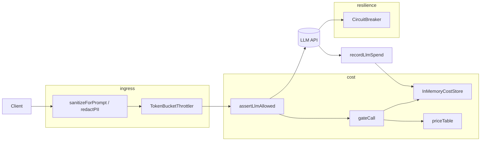

# llm-guardrails

[](https://github.com/marchikx/llm-guardrails/actions/workflows/ci.yml) 

## What it is and who it is for

`llm-guardrails` is a small TypeScript library for teams that call paid LLM APIs from a gateway or worker. It provides fail-closed spend ceilings, a kill switch, ROI gates by model tier, PII redaction, prompt sanitization, token-bucket throttling, and a simple circuit breaker—all with in-memory adapters so you can wire it in without Redis or a database.

It is for backend engineers building LLM proxies, agent runners, or internal tools who need predictable cost control and safer prompts before traffic hits a provider.

## Demo

```typescript
import {
  assertLlmAllowed,
  recordLlmSpend,
  InMemoryCostStore,
  sanitizeForPrompt,
  TokenBucketThrottler,
} from "llm-guardrails";

const store = new InMemoryCostStore();

const { correlationId } = assertLlmAllowed(
  "gpt-4o-mini",
  800,
  200,
  { organizationId: "acme", action: "draft.reply", expectedRevenueUpliftUsd: 5 },
  { store },
);

const safeUserText = sanitizeForPrompt(rawUserMessage);
// ... call your provider with safeUserText ...

recordLlmSpend(correlationId, { organizationId: "acme", action: "draft.reply" }, "gpt-4o-mini", 800, 200, {
  store,
});

const limiter = new TokenBucketThrottler(10, 10);
if (limiter.tryConsume().ok) {
  // proceed
}
```

## Quick start

```bash
git clone <your-fork> llm-guardrails
cd llm-guardrails
npm install
make verify
# or: npm run verify
```

`npm run verify` runs TypeScript checking and Vitest. Use `npm run build` to emit `dist/` for publishing.

## Architecture



## Decisions and tradeoffs

- **In-memory store** — Fast to adopt and test; not shared across processes. Swap `InMemoryCostStore` for your own adapter implementing the same surface.
- **Fail-closed gates** — Kill switch, $50 daily hard cap (configurable per call), TIER_4 blocked, and minimum ROI ratios mirror production gateway patterns without external deps.
- **No master bypass** — the only escape hatch is `skipRoiCheck` (for internal evals without a revenue estimate). It cannot override the kill switch, the hard cap, or the TIER_4 block; tests pin each of those.
- **Process-local store** — `InMemoryCostStore` counts spend per process. Behind several workers, implement the same `getDailySpendUsd` / `recordSpend` / `getKillSwitch` surface on Redis or Postgres, otherwise each replica gets its own $50.
- **Heuristic PII / injection filters** — Regex-based redaction and pattern stripping reduce accidental secret leakage; they are not a substitute for DLP or provider safety policies.
- **Synchronous API** — `gateCall` and `assertLlmAllowed` are sync for simplicity; async stores can wrap these at the edge.

## Tests

```bash
npm run verify
```

Coverage includes cost gate scenarios (kill switch, cap, TIER_4, cheap allow), PII redaction, token bucket exhaustion, and circuit breaker opening after failures.

## License MIT

This project is licensed under the MIT License. See [LICENSE](LICENSE).

---

**Hire note:** A typical paid integration task is: *install LLM spend ceiling in our gateway* — wire `assertLlmAllowed`, persist spend to your store, and enforce sanitization on every user-supplied prompt field.
